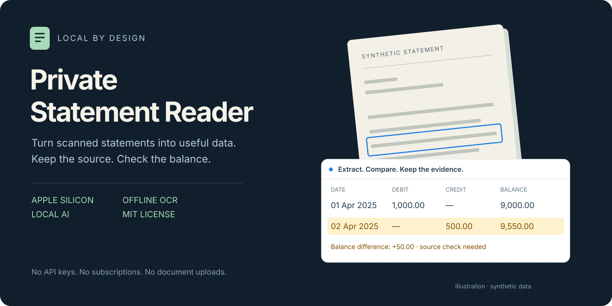
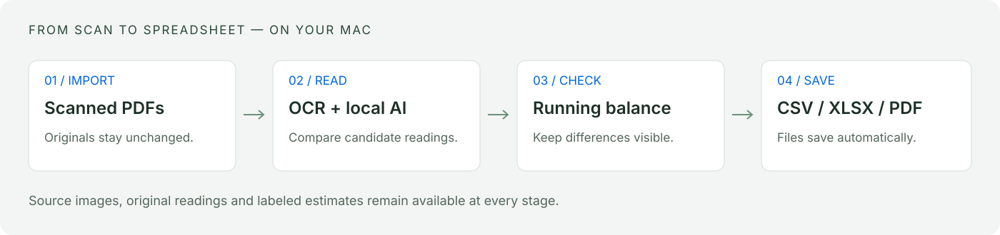

<p align="center">
  
</p>

<p align="center">
  <a href="#install">Install</a> ·
  <a href="#how-it-works">How it works</a> ·
  <a href="#accuracy-and-limits">Accuracy and limits</a> ·
  <a href="docs/USER_GUIDE.md">User guide</a> ·
  <a href="CONTRIBUTING.md">Contribute</a>
</p>

# Private Statement Reader

**A free, local bank-statement reader for Apple Silicon Macs.**

Convert scanned Indian bank statements into CSV, Excel and searchable PDF files.
Compare financial checks with their source images.
Check transaction amounts against the running balance.

No subscription. No API key. No cloud OCR service.

> **Early-stage software. Not a financial record of authority.**
> OCR and AI can make errors. A matching balance does not prove that every transaction is correct.
> Estimates remain labeled in the app and exported files.

## What you get

- **Bank-specific extraction.** Read dates, descriptions, cheque numbers, debits, credits and balances.
- **Original text and normalized text.** Keep both versions of the description.
- **Source-first review.** See the source crop above each financial check. Open the full-resolution page beside the review tools.
- **Automatic balance checks.** Find missing values, conflicting readings and balance differences.
- **Local AI support.** Use GLM-OCR through MLX for additional readings and labeled estimates.
- **Automatic exports.** Save each statement and a combined CSV/XLSX file without row approvals.
- **Resource controls.** Set a local memory budget, 1–8 simultaneous documents, OCR CPU parallelism and 1–2 AI instances. Hardware and memory pressure can reduce concurrency. RAM limits are best-effort, not OS-enforced quotas.
- **Mac controls.** Use a native AppKit toolbar, menus and file panels, with a Mac-styled document workspace.

The app supports light and dark appearance. It resumes from completed pages after a restart.

## How it works



1. Import the statement PDFs.
2. The app makes searchable PDFs and page images.
3. Several OCR passes identify the transaction table.
4. Table detection uses source positions, including the right edges of printed amounts, to separate columns and wrapped descriptions.
5. The local AI model supplies additional readings. Ordered matching checks dates, numbers and narration before attaching a proposal to an OCR row.
6. Balance checks compare the candidate amounts.
7. The app saves the results and marks unresolved readings.

The balance check uses integer paise:

```text
previous balance − debit + credit = current balance
```

The original PDF stays unchanged.
AI guesses and arithmetic estimates do not become confirmed source readings.
Processing does not stop for manual approval.
However, high-stakes use still requires independent checks.

AI tables with shifted, missing or extra cells are rejected when their columns cannot be established safely.
An ambiguous AI row does not replace an OCR row or create a likely duplicate.
Rejected proposals remain in the evidence record. A rejected proposal alone is not a conflict between printed OCR readings.
Accepted AI values stay labeled as estimates.

Arithmetic estimates use independently observed anchors within statement segments.
An estimated balance cannot supply the anchor for the next estimate.
Before changing saved rows at startup, the app makes a private backup.
It can then compare cached OCR passes and apply numeric repairs supported by two independent passes.
Each repair keeps a snapshot and its source evidence. Rows and manual edits are preserved.
This repair step needs no new AI model call or manual approval.

## Install

### Requirements

- An Apple Silicon Mac.
- macOS 14 or later for the base app.
- macOS 26 or later for the MLX runtime configuration tested in this project.
- Homebrew and Xcode Command Line Tools.
- Free disk space for OCR images, exports and optional model files.

The development machine had 16 GB of unified memory.
The app reduces new work when macOS reports memory pressure.
Two model copies share the same GPU. They do not guarantee twice the speed.

**This repository contains source code, not a ready-to-install binary.**
Build the app with the steps below.
Installation needs an Internet connection. Document processing stays local.

### 1. Get the source

```sh
git clone https://github.com/OjayitTanwar/private-statement-reader.git
cd private-statement-reader
```

### 2. Install the free tools

Install [Homebrew](https://brew.sh/) first.
Then install the command-line tools:

```sh
xcode-select --install
brew install python python@3.13 tesseract ocrmypdf poppler
```

Create the application environment with the same Python interpreter used by the Mac launcher:

```sh
/opt/homebrew/bin/python3 -m venv .venv
.venv/bin/python -m pip install -r requirements.txt
```

Do not use a different Python version for this environment.
Rebuild the app after a Homebrew Python version change.

### 3. Add local AI — optional

Skip this step for the base OCR app.
For the tested AI configuration, use Homebrew Python 3.13:

```sh
mkdir -p work
/opt/homebrew/bin/python3.13 -m venv work/ai-env
work/ai-env/bin/python -m pip install 'mlx-vlm==0.7.8' opencv-python huggingface_hub
work/ai-env/bin/python setup_ai.py
```

The setup downloads [GLM-OCR 8-bit](https://huggingface.co/mlx-community/GLM-OCR-8bit).
It uses revision `350a346bea43468bcd202abb833f7d32e9a17237`.
The weight file is approximately 1.58 GB.
The build includes the model when the environment and weights are present.
The model processes documents offline.

The optional environment also supplies OpenCV to the app build.
Without it, some image-based table recovery is unavailable.
The base OCR path remains available.

### 4. Build and open the app

```sh
.venv/bin/python build_mac.py
open 'outputs/Private Statement Reader.app'
```

The build creates an app and a ZIP file in `outputs/`.
You can move the app to Applications.
The app uses a local ad-hoc signature. It is not Apple-notarized.
Homebrew Python and OCR tools remain external dependencies.
The app does not include a complete Python interpreter.

<details>
<summary>Use the larger Tesseract English model</summary>

The build uses the installed English model by default.
To use `tessdata_best`, put its English model at `work/models/eng.traineddata` before the build:

```sh
mkdir -p work/models
curl --fail --location \
  https://raw.githubusercontent.com/tesseract-ocr/tessdata_best/main/eng.traineddata \
  --output work/models/eng.traineddata
```

This download tracks the upstream default branch.
The build records the downloaded file's SHA-256 hash.
Keep that hash if you need an exact model record.
See the [upstream model license](https://github.com/tesseract-ocr/tessdata_best/blob/main/LICENSE).

</details>

## Use the app

1. Select **Import PDFs** or press **⌘O**.
2. Select one or more statement PDFs.
3. Let the app finish the automatic checks.
4. Select **Finished Files** or press **⌘E**.

The output folder contains separate results for each statement.
It also contains combined CSV and XLSX files for completed statements.

Each row includes the date, both descriptions, cheque number, debit, credit, balance, page and OCR confidence.
Exports also preserve source identifiers, check results and estimate information.
CSV and XLSX text fields have spreadsheet formula protection.

The default **Financial checks** list contains concrete financial errors and estimated financial values or dates.
Name guesses, AI narration changes, weak aggregate OCR confidence and a missed row in another OCR pass appear in separate information notes unless a concrete numeric conflict exists.
The notes remain available in a collapsed section and a filter.
Source images stay above the extracted fields. This grouping changes no transaction values and removes no warnings.

CSV and XLSX include `review_category`, `review_required`, `review_reason`, `information_notes` and `legacy_suspicious`.
The `suspicious` column now follows `review_required`; `legacy_suspicious` preserves the earlier flag.
The original `reason` remains available.

Use **⌘F** to search descriptions, references and names.
Use **⌥⌘S** to show or hide the sidebar.
Use **View → Appearance** to select the system, light or dark appearance.

Closing the window does not stop processing.
Quitting the app stops processing. The next launch resumes from completed-page checkpoints.
Read the [user guide](docs/USER_GUIDE.md) for more detail.

## Accuracy and limits

This app prioritizes visible evidence over silent corrections.
It does **not** have a measured real-world accuracy percentage.

- Printed English Indian bank statements are the primary target.
- Faint, cut-off or complex scans can remain unreadable.
- Missing rows can pass balance checks if other errors cancel them.
- AI can produce plausible but incorrect numbers, descriptions or names.
- Confidence is an OCR quality score, not the probability that a row is correct.
- A guessed counterparty name is not a verified identity.
- Similar-sounding names are not silently merged.
- Some statement layouts remain unsupported.
- Thorough OCR can take substantial time. There is no fixed time guarantee for 300 pages.

Use the original statement as the source of authority.
Do not use unchecked exports for tax, legal, lending or accounting decisions.

## Privacy

Document processing runs on your Mac.
The app does not send statement images to an OCR API or an AI API.
It has no analytics or cloud account requirement.

The local service binds to a random port on `127.0.0.1`.
It uses a session token and checks requests.
Do not expose this service to a network or tunnel.

App data is stored here:

```text
~/Library/Application Support/Private Statement Reader/
```

The folder includes source PDFs, OCR text, previews, a database and exports.
The app does not encrypt these files.
Use macOS account protection, FileVault and protected backups.
Read [SECURITY.md](SECURITY.md) before you report a security problem.

## Develop and test

Run the unit tests:

```sh
.venv/bin/python -m unittest discover -s tests -p 'test_*.py' -v
node tests/test_evidence.cjs
node tests/test_triage_ui.cjs
```

The Python discovery command includes candidate safety, AI evidence matching, strict AI table parsing and cached source repair tests.
These use synthetic data and do not measure accuracy on real bank statements.

Run the end-to-end OCR test on a Mac with the OCR tools installed:

```sh
.venv/bin/python tests/smoke_local.py
```

The smoke test creates two synthetic statement pages.
One page has reduced contrast.
It checks OCR, searchable PDF output, exports, edits and balance checks.
It stores its data in `work/smoke-data`, not the app library.
Synthetic tests are not a real-world accuracy benchmark.

To use the development interface without the Mac wrapper:

```sh
.venv/bin/python app.py
```

Open the unique local session URL printed in the terminal.
Development data is stored in `data/` by default.
The development server does not enable optional AI unless you configure its environment.

## Project map

```text
native/           AppKit window, menus and Apple Vision helper
static/           Local document workspace and evidence review
app.py            Local service, job queue and document storage
bank_engine.py    OCR layout, dates, amounts and balance checks
table_grid.py     Image-based table detection and candidate selection
local_ai.py       Local model pool, cache and labeled estimates
automation.py     Checkpoints and automatic exports
review_checks.py  Financial checks and information-note classification
source_repair.py  Cached OCR consensus repairs with source provenance
people.py         Conservative name suggestions
tests/            Synthetic fixtures and source tests
```

Read [CONTRIBUTING.md](CONTRIBUTING.md) before you submit a change.
Never attach real bank statements to a public issue.

## License and credits

Application source and original repository artwork use the [MIT License](LICENSE).
Third-party tools and model files retain their own licenses.
This repository does not redistribute model weights or a packaged app.

Built with [Tesseract](https://github.com/tesseract-ocr/tesseract),
[OCRmyPDF](https://github.com/ocrmypdf/OCRmyPDF),
[Poppler](https://poppler.freedesktop.org/),
[OpenCV](https://github.com/opencv/opencv),
[MLX VLM](https://github.com/Blaizzy/mlx-vlm),
[GLM-OCR](https://github.com/zai-org/GLM-OCR),
[Pillow](https://python-pillow.github.io/) and
[openpyxl](https://openpyxl.readthedocs.io/).

Apple Vision, AppKit and WebKit are Apple system frameworks.
Apple Vision is optional and is not open source.
Before you redistribute a binary, review all dependency and model license requirements.

**Writing style:** This README uses short instructions and consistent terms inspired by
[ASD-STE100](https://www.asd-ste100.org/about_STE.html).
It is not certified or fully checked against the controlled dictionary.
